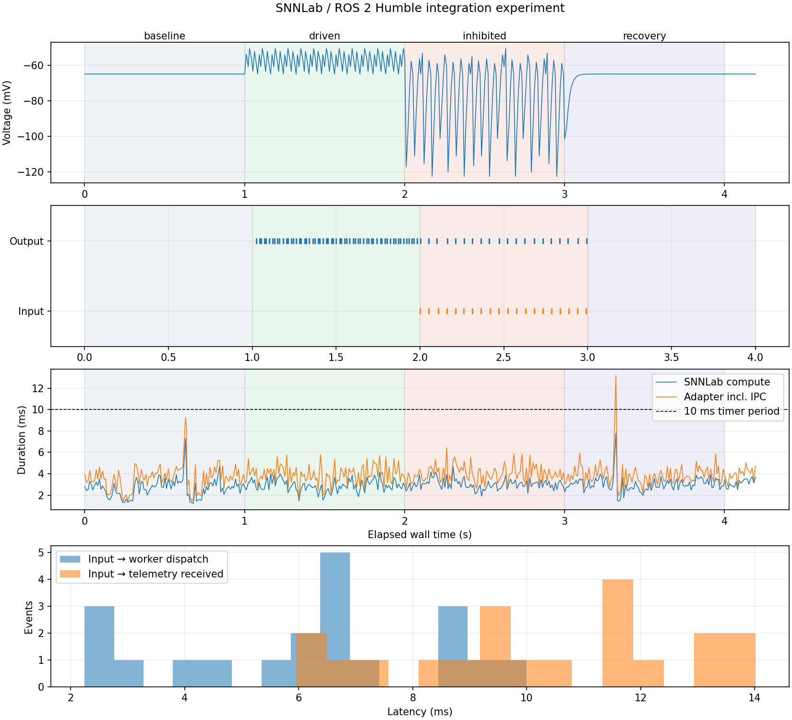

# snnlab-ros2

A small experiment running [SNNLab](https://github.com/eoinmurray/snnlab) as a
ROS 2 Humble node inside Docker. It receives current and inhibitory events,
simulates one spiking neuron, and publishes its voltage and spikes.

## Run

Start Docker. You also need Python 3 on your laptop; everything else is
installed inside the container.

```bash
./scripts/run-test.sh
```

The script builds the image using Docker's cache, runs the test, saves the
figure and results in `artifacts/`, and updates this README. Each run's raw
data and logs are saved under `artifacts/runs/`.

## The test

The test sends inputs through ROS and records the neuron's response. Each
stage lasts one second:

1. No current: the neuron should stay quiet.
2. Apply current: the neuron should start firing.
3. Add inhibitory events: these should suppress its activity.
4. Remove the current: the neuron should return to rest.

The figure shows voltage, input and output spikes, processing times, and the
delay between sending an input and receiving confirmation that it was processed.

## Results

<!-- experiment-result:start -->
The latest test **passed** on 23 October 2026. 10 of 10 checks passed. 20 of 20 input events were processed.



The neuron fired 61 times with current applied, and 20 times when inhibitory inputs were added. It fired 0 times before the current was applied and 0 times after it was removed.

Each update advances 10 ms of simulated time. 95% of updates took at most 5.34 ms, including communication with the simulation worker. 1 of 400 updates took longer than the 10 ms target; the slowest took 13.21 ms. This does not guarantee that every future update will finish on time.

[Full results](artifacts/summary.json)
<!-- experiment-result:end -->

## Code

`node.py` handles ROS messages. `simulation.py` defines and advances the SNNLab
network. `worker.py` connects them through a local pipe, keeping their Python
dependencies separate. `experiment.py` sends test inputs, checks the outputs,
and makes the figure. These files are in `src/snnlab_ros2/snnlab_ros2/`.

The topics follow the team's `custom_ring` example. This tests the ROS
connection with a simple neuron; it does not reproduce the ring oscillator.
