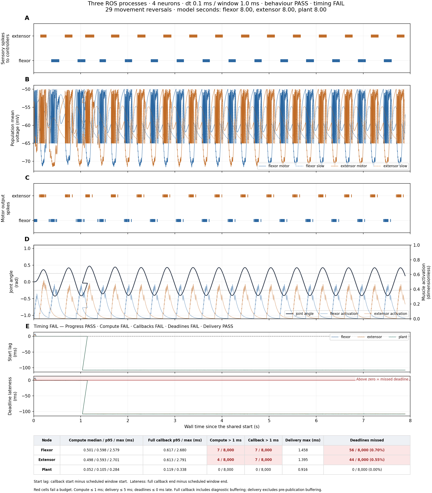

# SNNLab joint controller

Two spiking controllers communicate through ROS 2 Humble to move a simulated
joint back and forth. The flexor pulls in one direction; the extensor pulls in
the other. Each controller contains a motor neuron and a slow inhibitory
neuron. A third model node simulates the joint and returns sensory spikes.

This is a small robotics benchmark: can separate neural controllers coordinate
movement while keeping up with wall time? The recorded run produces alternating
movement without hitting the mechanical stops and completes eight model seconds
on every node. It passes the behaviour checks, but fails strict timing checks.
A clock discrepancy in the retained run limits interpretation of schedule lag
and deadline counts; see the timing results below.

## Quickstart

Install and start Docker with at least four available CPUs, then run:

```bash
./run.sh
```

The script builds the image using cached layers where possible, runs the
standalone reference and the ROS experiment, and copies the results out of the
container. ROS does not need to be installed on the host. Docker uses `uv` to
install the dependencies, including SNNLab 0.25.0 pinned to
`d2c7e82c1460fb3ee6e0f473331f0c3fe4db05fb` and PyTorch 2.10.0 CPU.
The image includes `setuptools` and the C++ toolchain needed by PyTorch's compiler.

On Colima, a separate profile avoids changing the resources of existing containers:

```bash
colima start --profile snnlab-ros2 --cpus 4 --memory 4 --disk 20 --activate=false
```

The runner selects `colima-snnlab-ros2` when that context exists. Set
`SNNLAB_DOCKER_CONTEXT` to override the context explicitly. The container is
allowed CPUs 0–3; flexor, extensor, plant and recorder are pinned to CPUs 0, 1,
2 and 3 respectively. These are separate virtual CPUs, not exclusive host cores.

The defaults are eight seconds, a 0.1 ms numerical step, a 1 ms control window
and four neurons in total. Each callback advances ten numerical steps.
`--timer-ms` sets the interval between absolute releases; independent ROS
timers are not used. If a node falls more than 20 ms behind, it stops its model
and the run fails. Set `--max-lag-ms` to change that limit.
To run only the ROS experiment with a larger network:

```bash
./run.sh --ros2-only --dt-ms 0.1 --timer-ms 1 --neurons 16
```

`--neurons N` creates N motor and N slow inhibitory neurons in each controller,
for 4N neurons total. Dense weights and muscle decoding are normalized so that
increasing N tests workload size while preserving the small model's dynamics.
These are synchronized replicas, rather than a more varied neural circuit.

Results go to `artifacts/basic/` and `artifacts/ros2/`. Each contains
`experiment.png`, `traces.npz` and `summary.json`; the ROS folder also contains
node logs. A behaviour or timing failure returns exit code 1 **after exporting
the results**. The included default ROS run returns failure for timing, while
passing the behaviour checks. Selected runs overwrite their corresponding artifacts.
The figures and JSON summaries are retained in Git; raw `traces.npz` recordings
and node logs are local outputs. The retained ROS run uses SNNLab 0.25.0;
`artifacts/basic` is an older SNNLab 0.24.1 reference and has not been rerun
after the upgrade.

To measure time inside each callback stage, run:

```bash
./run.sh --ros2-only --profile-timing
```

Profiling is off by default. It adds wall-clock and calling-thread CPU
measurements for input preparation, SNNLab execution, output extraction, spike
publication and the full callback. Results include `timing_profile.png`, raw
stage arrays in `traces.npz`, and `timing_profile` in `summary.json`. The included
ROS figure is from the latest unprofiled run, so no stage timing figure or
stage arrays are included. With profiling enabled, clock reads and stage
recording add overhead that is included rather than subtracted.

For the standalone reference without Docker or ROS, install `uv` and run:

```bash
uv run python src/basic_sim.py
```

## The task

The goal is repeated, bounded movement of a single rotary joint. Motor spikes
increase the activation of two opposing virtual muscles. Activation decays
between spikes, and the resulting torque moves a joint with inertia, damping
and a centring spring.

The controllers inhibit one another. Each motor neuron also excites its local
slow neuron, which feeds inhibition back to the motor neuron. This slow negative
feedback helps activity transfer between the two sides. Both controllers receive
equal local tonic excitation after a brief, 20 model-millisecond bias to the
flexor. No timed sequence forces the ongoing alternation.

When the angle exceeds +0.25 radians, the plant sends sensory spikes to the
extensor. Below −0.25 radians, it sends them to the flexor. These thresholds
request a change of direction; they are not physical barriers. Mechanical stops
are at ±1 radian.

Success requires alternating motor activity, repeated movement without hitting
the stops, and every node advancing its model at the intended wall-clock rate.
Movement alone is not enough to pass the timing benchmark.

## Code and architecture

```text
snnlab-ros2/
├── Dockerfile
├── run.sh
├── README.md
├── pyproject.toml
├── src/
│   ├── recipe.py
│   ├── node_flexor.py
│   ├── node_extensor.py
│   ├── node_plant.py
│   ├── basic_sim.py
│   ├── test.py
│   └── present.py
└── artifacts/
    ├── basic/
    │   ├── experiment.png
    │   ├── traces.npz
    │   └── summary.json
    └── ros2/
        ├── experiment.png
        ├── traces.npz
        ├── summary.json
        ├── node_flexor.log
        ├── node_extensor.log
        └── node_plant.log
```

1. **`recipe.py`** defines the shared neural controller and mechanical joint.
   SNNLab's built-in conductance-based LIF neurons and AMPA/GABA synapses provide
   the neural dynamics. ROS controllers use `compile_mode="default"` with ten-step
   compiled blocks through SNNLab 0.25.0 `prepare_stream`. The prepared session
   caches graph metadata and masked weights and privately owns continuing state.
   Native C++ wrapper dispatch and eligible batched projections are selected by
   SNNLab. Initial and continuation calls are warmed at the actual callback shape
   before readiness, including input preparation and output extraction; warm-up
   state is discarded with `stream.reset()`. Input tensors are reused, while
   `stream.advance` validates and copies them into session-owned buffers and
   returns independent outputs. The current standalone code also uses prepared
   streams, with compiled single-step kernels for its fine-grained feedback loop.
2. **`node_flexor.py`** runs the flexor controller and contains the shared ROS
   runtime: parameters, spike messages, absolute scheduling and buffered recording.
   A persistent ROS executor handles inputs while waiting for each release.
3. **`node_extensor.py`** starts a separate instance of that controller runtime
   for the extensor, with its own prepared SNNLab session and state.
4. **`node_plant.py`** runs the mechanical joint, decodes motor spikes into muscle
   activation and encodes joint-limit feedback as sensory spikes. It has no neurons.
5. **`basic_sim.py`** runs the same models without ROS. It provides a deterministic
   reference with a one-step delay between the controllers.
6. **`test.py`** starts the three model processes and adds a recorder ROS node.
   After discovery and warm-up, it sets a shared future start time, collects
   spikes and diagnostics, and reports behaviour and timing separately.
7. **`present.py`** generates experiment figures and the optional ROS stage timing
   figure from recorded data. For example,
   `uv run python src/present.py artifacts/ros2` redraws the ROS figure without
   rerunning the experiment.

ROS carries motor spikes on `/motor/flexor` and `/motor/extensor`. Each motor
stream goes to both the opposing controller and the plant. Sensory spikes use
`/sensory/flexor` and `/sensory/extensor`. One `Int64MultiArray` message represents
one spike and contains
`[sequence, publication_timestamp_ns, neuron_id, source_model_time_ns]`.
Source model time is relative to that node's model origin, not a wall-clock
publication timestamp. Each controller executes a complete window in one SNNLab
call. Inputs already received enter once at the first substep; output spikes
are published after the window, retaining their individual model times.
The plant also integrates ten mechanical substeps per callback.

Startup uses parameter services. Separate diagnostic topics carry voltages,
plant state and timing records; those continuous values are not control inputs.
Spike delivery age is measured from actual publication to receipt inside each
receiving model node. It excludes time before publication, including window
buffering and model lag. Diagnostics retain every neural substep; panel B
shows population means at callback completion. Numeric traces go into preallocated
buffers during control. JSON conversion and diagnostic publication happen only
after the shared control interval, and the recorder waits for every export to
finish. Cyclic garbage collection is deferred until after this bounded run;
ordinary reference-counted cleanup still happens during it. This buffering
uses memory proportional to the requested duration, not an indefinite stream.

## ROS experiment



The included figure records an eight-second wall-clock run with three model
nodes, four neurons, a 0.1 ms numerical step and a 1 ms callback period. All
panels share the same recorded wall-time axis, which contains the clock
discrepancy described below. Full measurements are in the
[ROS summary](artifacts/ros2/summary.json).

## Reading panels A–E

### A — Sensory input spikes

**Expected:** crossing the positive angle threshold recruits the extensor;
crossing the negative threshold recruits the flexor. Sensory spikes should
therefore arrive in alternating groups as the joint moves.

**Observed:** both feedback streams are active, with 216 spikes sent to the
flexor and 245 to the extensor. The groups follow excursions beyond the angle
thresholds. They come from the moving plant, not a prerecorded stimulus.

### B — Internal voltages

**Expected:** the active motor neuron repeatedly reaches its firing threshold
and resets, while inhibition holds its partner quieter. The slow inhibitory
neurons should change activity as local feedback builds and decays.

**Observed:** the motor traces show alternating firing and inhibited phases,
with the dashed slow-neuron traces changing alongside them. The plotted values
are population means; at the default size, each population contains one neuron.
This is consistent with the intended reciprocal controller.

### C — Motor output spikes

**Expected:** flexor and extensor motor bursts should mostly take turns,
producing opposing muscle commands at different times.

**Observed:** the flexor emits 162 spikes and the extensor 167, mostly in
alternating bursts. This supplies a repeated sequence of opposing motor commands.
The closed-loop figure shows coordination; it does not by itself separate the
contributions of sensory feedback and the controller's internal rhythm.

### D — Joint movement and muscle activation

**Expected:** motor bursts raise the corresponding muscle activation, followed
by a change in movement. Inertia and the gradual decay of activation allow the
joint to pass the sensory thresholds before reversing.

**Observed:** the joint reverses direction 29 times and stays between −0.426
and +0.471 radians, well inside the mechanical stops. Both muscles take turns
activating. This run passes the movement and stop-avoidance checks.

### E — Timing

Panel E contains two timing traces and a summary table. Both traces share the
wall-time axis with panels A–D. Colours identify the same three model nodes.

1. **Start lag** shows how late a callback starts relative to its scheduled
   model window. Zero means on schedule; a flat positive line means a persistent
   offset, while an upward trend means growing lag.
2. **Deadline lateness** shows full callback completion minus the scheduled
   window end. Anything above zero, in the red region, misses its deadline.
3. **The table** separates compute cost from scheduling and spike delivery.
   It shows compute median/p95/maximum, full callback p95/maximum, counts exceeding
   1 ms, maximum delivery age, and deadline misses as counts and percentages.
   Full callbacks include spike publication and diagnostic-buffer writes.
   Red cells mark failed budgets; the status line names passing and failing checks.

**Expected:** every update should finish within its 1 ms step budget and by its
absolute deadline. Spikes should arrive within the configured 5 ms delivery
budget. Each model should advance eight seconds during eight wall-clock seconds.

**Observed:** each node completes eight model seconds. Full callback p95 times
are 0.617 ms for the flexor, 0.613 ms for the extensor and 0.119 ms for the plant.
The recorded deadline misses are 56 of 8,000 (0.70%), 44 (0.55%) and zero,
respectively. Maximum recorded deadline lateness is 7.557 ms in the flexor.
Every measured spike delivery stays below 1.459 ms, with no detected sequence
gaps. Both controllers have seven callbacks exceeding the 1 ms budget, so the
strict timing check fails independently of the deadline-count limitation below.

The lag traces contain a clock discrepancy: 6,857 of 8,000 callbacks per node
have negative recorded start lag, with controller medians near −107.7 ms.
Scheduling uses `perf_counter_ns`, but exported start lag uses ROS wall time;
exported deadline lateness adds the measured callback duration to that wall-time
lag. The clocks therefore cannot be assumed to remain aligned in this run.
The cause has not been established. Recorded deadline counts and the wall-time
axis need investigation before they can support deadline-reliability claims.
Callback durations use `perf_counter_ns` and do not use the ROS wall-clock offset.
Spike delivery ages also use ROS wall time, so they are reported measurements
rather than an independent validation of clock alignment.

## Key parameters

Values for the included four-neuron run. Model times are simulated times;
the control-window interval is wall time.

| Parameter | Value |
| --- | --- |
| Run duration | 8 wall-clock seconds |
| Simulation step / control-window interval, all nodes | 0.1 ms / 1 ms |
| Numerical steps per ROS callback | 10 |
| ROS execution | Prepared streams with compiled ten-step blocks, warmed before readiness |
| Neural precision / backend | Float64 / PyTorch 2.10.0 CPU |
| Controller preparation | Approximately 7.8 s per process, outside the control interval |
| Scheduling / maximum start lag | Absolute 1 ms releases / stop above 20 ms |
| Diagnostics | Buffered during control; exported afterward |
| Stage profiling in the included run | Disabled |
| CPU allocation | One virtual CPU each for flexor, extensor, plant and recorder |
| Neurons per controller | 1 motor + 1 slow inhibitory; 4 total |
| Membrane time constants, motor / slow | 20 ms / 80 ms |
| Slow inhibitory feedback decay | 250 ms |
| Inhibition between controllers: decay | 20 ms |
| Local tonic excitatory conductance | 0.03 µS per motor neuron |
| Initial flexor bias | Additional 0.02 µS for 20 model ms |
| Muscle activation decay | 80 ms |
| Sensory thresholds / mechanical stops | ±0.25 rad / ±1 rad |
| Spike delivery budget | 5 ms |

## Timing results after prepared streaming

The dependency is pinned to SNNLab 0.25.0 (`d2c7e82`). Controllers now use
`prepare_stream`, including cached metadata/weights, private continuing state,
native C++ compiled wrapper dispatch and eligible batched projections. Float64,
the network, 0.1 ms numerical step, ten-step window, CPU allocation and scheduling
limits remain the same.

The latest unprofiled run in `artifacts/ros2/summary.json` completed eight model seconds
on all nodes and passed behaviour checks, but failed strict timing checks.
Deadline counts below are the recorded values, subject to the clock discrepancy
above:

| Node | Callback median / p95 / maximum | Deadline misses |
| --- | ---: | ---: |
| Flexor | 0.516 / 0.617 / 2.680 ms | 56 / 8,000 |
| Extensor | 0.513 / 0.613 / 2.791 ms | 44 / 8,000 |
| Plant | 0.063 / 0.119 / 0.338 ms | 0 / 8,000 |

A fresh unprofiled 0.24.1 run provided the historical comparison below.
Only the latest prepared-stream run is retained under `artifacts/ros2`; the
comparison runs were removed during artifact cleanup.
Both completed all eight seconds and passed behaviour checks; both failed timing.
Each node executed 8,000 callbacks with a 1 ms budget.

| Node | Old → prepared median | Old → prepared p95 | Old → prepared maximum | Old → prepared deadline misses |
| --- | ---: | ---: | ---: | ---: |
| Flexor | 0.515 → 0.516 ms | 0.634 → 0.617 ms | 2.624 → 2.680 ms | 78 → 56 |
| Extensor | 0.514 → 0.513 ms | 0.632 → 0.613 ms | 2.625 → 2.791 ms | 93 → 44 |
| Plant | 0.056 → 0.063 ms | 0.111 → 0.119 ms | 0.370 → 0.338 ms | 3 → 0 |

Cross-version checks compared both controllers over 1,000 steps each with both
one-step and ten-step windows: voltages matched within 1e-12 mV, and spikes and
event indices matched exactly. Continuation, warm-up discard and reset passed.
Ruff and Python compilation checks also passed.

There is no meaningful controller median speedup in this pair. Controller
p95 times fell approximately 2.7–3.0%, while maximum callback times rose slightly.
The apparent fall in controller deadline misses from 171 to 100 cannot establish
improved scheduling because the latest run's lag measurements have the clock
discrepancy described above. These are single sequential runs in a macOS/Colima
VM; scheduling and host load vary. The comparison measures the dependency upgrade
and prepared-session integration together, so it does not isolate
`prepare_stream`, native dispatch or projection batching.

Warm-up and compilation occur before the shared control interval. JSON conversion
and diagnostic publication occur after control. Callback measurements include publication and diagnostic-buffer writes.
Spike delivery measurements exclude pre-publication buffering, including the
ten-step output window. The latest run recorded no late or missing spikes under
the 5 ms delivery budget.

These measurements cover a simulated joint and local ROS communication, without
physical sensors, motors or inter-machine networking. They do not establish a
hard real-time guarantee. Repeated native Linux runs are needed to assess deadline
reliability beyond this virtual machine.

## Retained standalone reference

`artifacts/basic` predates the prepared-stream upgrade: its summary records
SNNLab 0.24.1 and single-step compiled execution. It simulates eight model
seconds in 54.94 wall seconds, excluding setup, with 29 movement reversals and
no mechanical-stop hits. It runs without pacing or ROS and exchanges feedback
every 0.1 ms, whereas the ROS controllers advance ten steps per callback. Its
runtime is therefore not a measurement of the current 0.25.0 standalone code
or a direct comparison with the ROS callback timings. Run `./run.sh --basic-only`
to regenerate it with the current dependency and prepared-stream integration.
